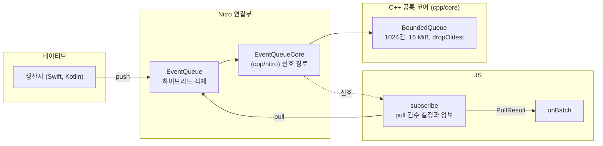

# react-native-velo

> React Native에서 네이티브가 JS로 자주 보내는 이벤트 스트림의 전달을 개선하는 라이브러리
>
> 네이티브 생산자가 넣은 이벤트를 C++ `BoundedQueue`에 모아 JS가 처리할 수 있는 만큼 묶어서 가져가는 구조

[](https://github.com/opficdev/react-native-velo/actions/workflows/ci.yml)

## 프로젝트 개요

이벤트는 네이티브 생산자의 `push`에서 시작해 `BoundedQueue`와 Nitro 하이브리드 객체를 거쳐 JS 구독자의 `onBatch`로 전달

| 영역 | 담당 | 위치 |
|---|---|---|
| 네이티브 생산자 | 받은 스트림에 직접 `push` | 사용하는 앱의 모듈 (예제: `example/producer/`) |
| C++ 공통 코어 | `BoundedQueue`의 건수와 바이트 제한, 신호 대기 판정 | `cpp/core/` |
| 연결 클래스 | 고정값(1024건, 16 MiB, `dropOldest`), 신호 경로, `Batch`를 `PullResult`로 변환 | `cpp/nitro/EventQueueCore` |
| Nitro 하이브리드 객체 | `EventQueue`를 Swift와 Kotlin으로 구현하고 둘 다 `EventQueueCore`를 호출 | `ios/`, `android/` |
| JS 구독자 | `createEventStream`, `subscribe`의 `pull` 건수 결정과 양보, `connect` | `src/` |



## 주요 기능

- JS 스레드를 거치지 않는 네이티브 생산자의 스트림 직접 `push`
- 소유 버퍼는 무복사, 빌린 버퍼는 `push`를 부른 스레드에서 복사
- 큐가 가득 차면 오래된 항목부터 폐기, 폐기 건수는 `PullResult.dropped`로 전달
- 신호 한 번에 `pull` 한 번을 부르고 적체가 이어지면 `setTimeout(fn, 0)`으로 양보
- 스트림당 생산자 하나와 구독자 하나만 허용, 두 번째 호출은 `Error` 발생
- `dispose` 뒤의 `push`는 오류 없이 무시

## 설치

- [Releases](https://github.com/opficdev/react-native-velo/releases)에서 설치할 버전을 골라 `<버전>`에 입력

```bash
npm install https://github.com/opficdev/react-native-velo/releases/download/<버전>/react-native-velo-<버전>.tgz react-native-nitro-modules@^0.37.1
```

- `react-native-nitro-modules`는 peer dependency라 함께 설치
- `peerDependencies` 범위
	- `react`: `*`
	- `react-native`: `^0.88.0`
	- `react-native-nitro-modules`: `^0.37.1`
- 한계
	- npm 레지스트리에 올라가 있지 않아 `npm install react-native-velo`로 설치 불가
	- `^0.1.0` 같은 버전 범위로 자동 업데이트 불가, 버전마다 URL 변경

## 사용 흐름

첫 사용은 생산자 선언, 네이티브 `push`, JS 연결의 세 단계

- iOS는 설치 뒤 `ios/` 폴더에서 `pod install` 실행
- 생산자 모듈을 직접 만드는 경우 모듈이 라이브러리에 의존하도록 설정 필요

### 1. 생산자 선언

`EventQueue`를 받는 `start`와 `stop`을 가진 Nitro 모듈 선언

```ts
// example/producer/src/specs/example-producer.nitro.ts
import type { HybridObject } from 'react-native-nitro-modules';
import type { EventQueue } from 'react-native-velo/src/specs/event-queue.nitro';

export interface ExampleProducer extends HybridObject<{
  ios: 'swift';
  android: 'kotlin';
}> {
  // 스트림을 받아 생산 시작
  start(stream: EventQueue): void;
  // 생산 중단과 스트림 참조 해제
  stop(): void;
}
```

### 2. 네이티브 `push`

받은 스트림에 `push`

```swift
// example/producer/ios/HybridExampleProducer.swift
import EventStream
import Foundation
import NitroModules

final class HybridExampleProducer: HybridExampleProducerSpec {
  func start(stream: (any HybridEventQueueSpec)) throws {
    var count = UInt64(0)
    // ... 100ms마다 실행되는 타이머의 이벤트 핸들러 안
    count += 1
    // 이 파일에 버퍼 타입 이름이 없으면 push가 보이지 않아 타입 명시
    let buffer: CounterBuffer = makeCounterBuffer(count)
    // dispose된 큐의 push는 오류 없이 무시되므로 결과 확인 생략
    try? stream.push(data: buffer)
    // ...
  }
}
```

- Android 생산자는 Kotlin으로 같은 `start`와 `stop`을 구현하며 예제는 [`HybridExampleProducer.kt`](example/producer/android/src/main/java/com/margelo/nitro/exampleproducer/HybridExampleProducer.kt) 참고
- 주의: Swift에서 `EventStream`을 가져오는 파일은 `ArrayBuffer` 직접 사용 불가, `example/producer/ios/CounterBuffer.swift`의 별칭 사용
- 주의: 컴파일러 버전마다 거부하는 표기가 달라 이 별칭 사용, 원인은 확인 못함

### 3. JS 연결

`createEventStream`으로 만든 스트림에 구독자와 생산자 연결

```ts
// example/bench/runner.ts 발췌
const stream = createEventStream();
const unsubscribe = stream.subscribe(onBatch);
const disconnect = stream.connect(producer);
// 종료 시점에 unsubscribe()와 disconnect() 호출
```

- `onBatch`는 `PullResult`(`items`, `dropped`)를 받는 함수, `producer`는 1단계에서 선언한 모듈의 하이브리드 객체
- `subscribe`와 `connect`는 해제 함수를 반환, 호출 순서 제한 없음
- 생산자 모듈이 라이브러리에 의존하도록 설정 필요
	- iOS는 podspec에 `s.dependency 'EventStream'` 필요
	- Android는 `find_package(react-native-velo REQUIRED CONFIG)`와 `react-native-velo::EventStream` 링크와 Gradle의 `project(":react-native-velo")` 의존 필요
- 전체 흐름은 [`example/`](example)과 [`example/producer/`](example/producer)에서 확인 가능

## 핵심 성과

1~3은 라이브러리를 쓰지 않은 Nitro 콜백 경로(B)와 이 라이브러리의 큐 경로(Q)를 같은 앱 실행 안에서 번갈아 측정한 결과이고 4는 큐 경로의 빌드 간 비교

- `onBatch` 핸들러의 부하는 fast가 추가 작업 없음, slow가 이벤트당 발행 간격의 50%, overload가 120%만큼 JS 스레드 점유
- 루프 지연: 10ms 간격 JS 타이머가 예정보다 늦게 실행된 시간으로, JS 타이머 밀림의 지표
- ready: 이벤트 발행 시각부터 `onBatch`에서 처리가 시작되는 시각까지의 시간
- p99: 99번째 백분위수
- 표의 값은 3회 중앙값이며 각 칸은 B / Q 순서

### 1. 처리가 못 따라갈 때 JS 타이머 밀림 감소

> **문제**: 네이티브가 JS의 처리 속도보다 빠르게 이벤트를 보내면 Nitro 콜백 경로에서 JS 타이머가 수 초에서 십수 초 지연
>
> **해결**: 네이티브 생산자가 C++ `BoundedQueue`에 직접 `push`하고 JS는 처리 시간 한도 안에서만 Batch를 가져가며 한도에 닿으면 양보
>
> **성과**: overload에서 JS 타이머 밀림이 iOS 64KB는 12,008ms에서 22.0ms로, Android 64KB는 2,334ms에서 52.2ms로 감소

| 플랫폼 | 크기, 발행 속도 (overload) | JS 타이머 밀림: 루프 지연 p99 (ms) B / Q |
|---|---|---|
| iOS | 1KB, 5,000/s | 12,064 / 22.8 |
| iOS | 64KB, 500/s | 12,008 / 22.0 |
| iOS | 1MB, 50/s | 11,996 / 18.3 |
| Android | 1KB, 5,000/s | 4,464 / 32.7 |
| Android | 64KB, 500/s | 2,334 / 52.2 |
| Android | 1MB, 50/s | 1,970 / 27.2 |

### 2. 이벤트 지연과 메모리 증가를 큐 한도 안으로 제한

> **문제**: Nitro 콜백 경로는 처리하지 못한 이벤트가 쌓이는 동안 지연과 메모리가 계속 늘어남
>
> **해결**: `BoundedQueue`에 건수와 바이트 상한을 두고 가득 차면 오래된 항목부터 폐기하고 폐기 건수를 `PullResult.dropped`로 전달
>
> **성과**: overload에서 이벤트가 처리되기까지의 ready p99가 iOS 1KB는 2,058ms에서 289ms로, Android 1KB는 4,737ms에서 481ms로 감소했고 메모리는 모든 시나리오에서 시작값 대비 15MB 이내

| 플랫폼 | 크기, 발행 속도 (overload) | ready p99 (ms) B / Q | 처리량 (건/초) B / Q | Q 폐기 건수 |
|---|---|---|---|---|
| iOS | 1KB, 5,000/s | 2,058 / 289 | 4,140 / 3,152 | 17,271 |
| iOS | 64KB, 500/s | 2,001 / 869 | 416 / 283 | 1,904 |
| iOS | 1MB, 50/s | 1,988 / 368 | 42 / 40 | 84 |
| Android | 1KB, 5,000/s | 4,737 / 481 | 3,453 / 2,431 | 24,758 |
| Android | 64KB, 500/s | 2,658 / 893 | 399 / 275 | 2,040 |
| Android | 1MB, 50/s | 2,193 / 491 | 41 / 30 | 184 |

- 같은 구간에서 B의 메모리는 1MB overload 기준 iOS 약 15MB, Android 약 60MB 증가
- 주의: overload에서 Q의 처리량이 B보다 낮음, 처리하지 못한 이벤트는 오래된 것부터 폐기
- 주의: 처리량 감소의 원인은 양보 비용으로 추정하며 확인 못함
- 주의: 상한 1024건과 16 MiB는 측정으로 정한 값이 아니라 초기 고정값, 다른 상한과의 비교 안 함

### 3. 처리에 여유가 있을 때 추가 비용 없음

> **문제**: `BoundedQueue`와 신호 경로를 거치면 처리에 여유 있는 경우 지연이나 처리량 악화 가능
>
> **해결**: 신호 한 번에 `pull` 한 번으로 가져가고 양보는 적체가 이어질 때만 동작
>
> **성과**: fast와 slow 시나리오에서 처리량이 B와 동일하고 대부분의 시나리오에서 ready p99와 루프 지연 p99도 차이 없음

| 플랫폼 | 크기, 발행 속도, 핸들러 | 처리량 B / Q | ready p99 (ms) B / Q | 루프 지연 p99 (ms) B / Q |
|---|---|---|---|---|
| iOS | 1KB, 20,000/s, fast | 20,000 / 20,000 | 0.04 / 0.05 | 7.6 / 7.6 |
| iOS | 64KB, 2,000/s, fast | 2,000 / 2,000 | 0.09 / 0.11 | 7.6 / 7.7 |
| iOS | 1MB, 200/s, fast | 200 / 200 | 0.38 / 0.45 | 7.6 / 7.6 |
| Android | 1KB, 20,000/s, fast | 19,996 / 20,004 | 5.4 / 6.2 | 20.1 / 19.5 |
| Android | 64KB, 2,000/s, fast | 2,000 / 2,000 | 2.5 / 9.8 | 21.6 / 32.3 |
| Android | 1MB, 200/s, fast | 200 / 200 | 4.4 / 5.5 | 19.2 / 19.1 |

- 주의: Android 64KB 2,000/s fast에서는 Q의 ready p99와 루프 지연 p99가 B보다 높음

### 4. Batch 고정 비용 핸들러의 처리량 회복

> **문제**: Batch마다 고정 비용이 드는 핸들러에서 양보 판정을 처리 시간 기준으로 바꾼 뒤 처리량이 바꾸기 전보다 감소
>
> **해결**: `pull` 건수를 정하는 값을 Batch 고정 비용과 건당 증가 시간 `marginMs`로 구분
>
> **성과**: 고정 비용 8ms 핸들러의 처리량이 iOS는 90/s에서 3,841/s로, Android는 1,164/s에서 2,571/s로 회복

| 플랫폼 | Batch 고정 비용 | 양보 판정 변경 전 (건/초) | 양보 판정 변경 후 (건/초) | `pull` 건수 결정 변경 후 (건/초) |
|---|---|---|---|---|
| iOS | 8ms | 3,840 | 90 | 3,841 |
| iOS | 16ms | 2,770 | 60 | 2,768 |
| Android | 8ms | 1,902 | 1,164 | 2,571 |
| Android | 16ms | 1,888 | 373 | 1,844 |

| 항목 | 내용 |
|---|---|
| 기기 | iOS는 iPhone 18 Pro 시뮬레이터, Android는 `velo_example` 에뮬레이터 |
| 빌드 | 양보 판정 변경 전, 변경 후, `pull` 건수 결정 변경 후를 각각 Release로 빌드 |
| 구간 | 3회 측정, 최대 처리 속도의 90%로 발행, 3회 범위가 겹치지 않을 때만 차이로 봄 |

- 처리량은 핸들러가 1초에 처리한 이벤트 건수의 3회 중앙값이며 Q 경로만 측정
- Batch 고정 비용은 `onBatch` 호출마다 드는 처리 시간으로, 건수와 무관하게 Batch당 한 번 소비
- 핸들러는 Batch 고정 비용 8ms 또는 16ms를 쓰는 모의 핸들러
- 주의: Android 큰 이벤트 시나리오의 JS 타이머 밀림(루프 지연 p99)이 양보 판정 변경 후 23.30ms에서 `pull` 건수 결정 변경 후 40.77ms로 증가, 원인 특정 못함

### 1~3의 측정 조건

| 항목 | 내용 |
|---|---|
| 기기 | iOS는 iPhone 18 Pro 시뮬레이터, Android는 `velo_example` 에뮬레이터(`arm64-v8a`) |
| 빌드 | Release, 양보 판정을 처리 시간 기준으로 바꾼 뒤이며 `pull` 건수 결정을 바꾸기 전의 `subscribe` |
| 시나리오 | 크기 1KB, 64KB, 1MB와 발행 속도와 핸들러를 조합한 14개 |
| 구간 | 워밍업 2초, 측정 8초, 시나리오당 3회, 회차마다 B와 Q의 순서를 섞음 |

### 측정의 한계

- 주의: 시뮬레이터와 에뮬레이터에서 인공 핸들러로만 측정해 실제 앱의 JS 부하와 UI 프레임 영향은 확인 못함
- 주의: 현재 `develop`의 `pull` 건수 결정은 1~3의 측정 이후 변경, B와의 비교는 재측정 안 함
- 주의: B와 Q를 같은 프로세스에서 연속 실행해 메모리 비교는 대략적인 값
- 주의: `subscribe`의 내부 상수는 장치에서 정하지 않음

## 기술 스택

| 구분 | 내용 |
|---|---|
| 언어 | TypeScript 6.0.3, Swift, Kotlin, C++ |
| 런타임 의존 | `react`(`*`), `react-native`(`^0.88.0`), `react-native-nitro-modules`(`^0.37.1`) (`peerDependencies`) |
| 확인된 빌드 환경 | React Native 0.88.0, React 19.3.0, `react-native-nitro-modules` 0.37.1 |
| 코드 생성 | `nitrogen` 0.37.1 |
| 빌드 | `react-native-builder-bob` 0.40.18 |
| 정적 검사 | ESLint 10.13.0, Prettier 3.9.10, SwiftLint 0.65.1, ktlint 1.8.0, clang-format 23.1.3 |
| 자동화 | GitHub Actions, `mise`(Node 24.22.0, Java temurin 21, Ruby 4.0.7), `npm`, `Makefile` |

- `react-native`와 `react-native-nitro-modules`의 범위는 배포물에 들어간 `nitrogen` 0.37.1의 생성 코드와 빌드를 확인한 React Native 0.88.0에 맞춘 값
- iOS는 `min_ios_version_supported`를 따르며 React Native 0.88.0에서는 15.1
- Android는 라이브러리 기본값(`EventStream_minSdkVersion`)이 23이고 예제 앱의 `minSdkVersion`이 24
- 주의: visionOS 1.0은 podspec에 선언만 있고 visionOS와 Android SDK 23 빌드는 CI에서 미확인
- 네이티브 생산자는 iOS에서 Swift, Android에서 Kotlin으로 구현
- 배포물에 Nitro 생성 코드(`nitrogen/`)와 빌드 결과(`lib/`) 포함, 사용 앱의 코드 생성 실행 불필요

## 한계

- 큐 크기(1024건, 16 MiB)와 가득 찼을 때의 정책은 측정으로 정하지 않은 고정값, 설정 API 없음
- 스트림당 생산자 하나와 구독자 하나만 지원
- 측정 조건의 한계는 [측정의 한계](#측정의-한계) 참고

## 라이선스

MIT
