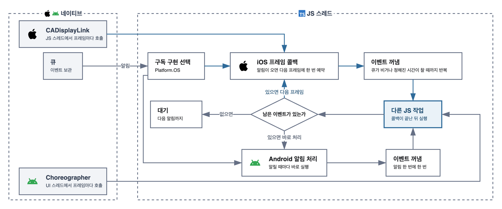
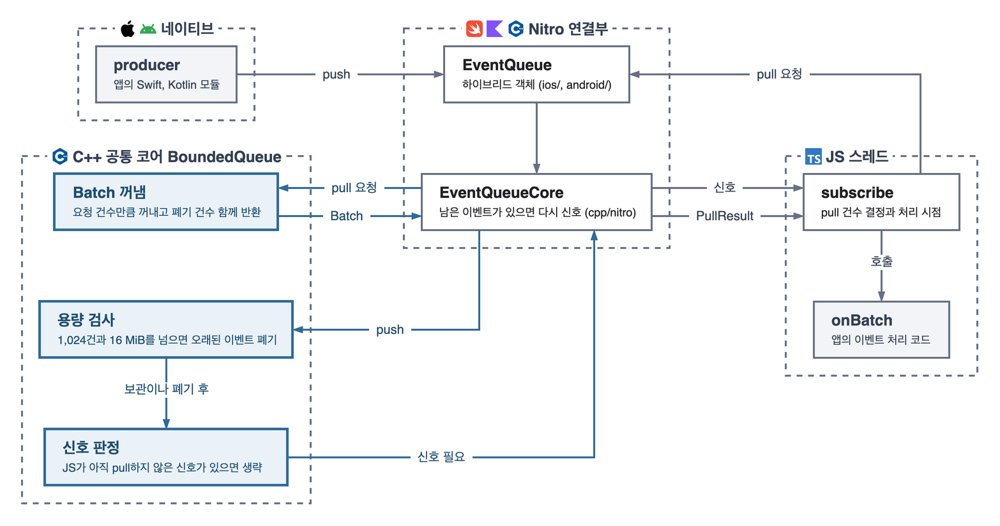

# react-native-velo

> 네이티브 이벤트가 몰릴 때 JS가 감당할 수 있는 만큼만 가져가게 하는 React Native 라이브러리
>
> 네이티브 producer가 넣은 이벤트를 C++ `BoundedQueue`에 모아 JS가 처리할 수 있는 만큼 묶어서 가져가는 구조

[](https://github.com/opficdev/react-native-velo/actions/workflows/ci.yml)

## 설치

- [Releases](https://github.com/opficdev/react-native-velo/releases)에서 설치할 버전을 골라 `<버전>`에 입력

```bash
npm install https://github.com/opficdev/react-native-velo/releases/download/<버전>/react-native-velo-<버전>.tgz react-native-nitro-modules@^0.37.1
```

- `react-native-nitro-modules`는 peer dependency라 함께 설치
- `peerDependencies` 범위
	- `react`: `*`
	- `react-native`: `^0.88.0`
	- `react-native-nitro-modules`: `^0.37.1`

## 사용 흐름

첫 사용은 producer 선언, 네이티브 `push`, JS 연결의 세 단계

- iOS는 설치 뒤 `ios/` 폴더에서 `pod install` 실행
- producer 모듈을 직접 만드는 경우 모듈이 라이브러리에 의존하도록 설정 필요

### 1. producer 선언

`EventQueue`를 받는 `start`와 `stop`을 가진 Nitro 모듈 선언

```ts
// example/producer/src/specs/example-producer.nitro.ts
import type { HybridObject } from 'react-native-nitro-modules';
import type { EventQueue } from 'react-native-velo/src/specs/event-queue.nitro';

export interface ExampleProducer extends HybridObject<{
  ios: 'swift';
  android: 'kotlin';
}> {
  // 스트림을 받아 생산 시작
  start(stream: EventQueue): void;
  // 생산 중단과 스트림 참조 해제
  stop(): void;
}
```

### 2. 네이티브 `push`

받은 스트림에 `push`

```swift
// example/producer/ios/HybridExampleProducer.swift
import EventStream
import Foundation
import NitroModules

final class HybridExampleProducer: HybridExampleProducerSpec {
  func start(stream: (any HybridEventQueueSpec)) throws {
    var count = UInt64(0)
    // ... 100ms마다 실행되는 타이머의 이벤트 핸들러 안
    count += 1
    // 이 파일에 버퍼 타입 이름이 없으면 push가 보이지 않아 타입 명시
    let buffer: CounterBuffer = makeCounterBuffer(count)
    // dispose된 큐의 push는 오류 없이 무시되므로 결과 확인 생략
    try? stream.push(data: buffer)
    // ...
  }
}
```

- Android producer는 Kotlin으로 같은 `start`와 `stop`을 구현하며 예제는 [`HybridExampleProducer.kt`](example/producer/android/src/main/java/com/margelo/nitro/exampleproducer/HybridExampleProducer.kt) 참고
- 주의: Swift에서 `EventStream`을 가져오는 파일은 `ArrayBuffer`를 직접 쓸 수 없어 `example/producer/ios/CounterBuffer.swift`의 별칭 사용
- 주의: 컴파일러 버전마다 거부하는 표기가 달라 이 별칭을 쓰며 원인은 확인 못함

### 3. JS 연결

`createEventStream`으로 만든 스트림에 subscriber와 producer 연결

```ts
// example/bench/runner.ts 발췌
const stream = createEventStream();
const unsubscribe = stream.subscribe(onBatch);
const disconnect = stream.connect(producer);
// 종료 시점에 unsubscribe()와 disconnect() 호출
```

- `onBatch`는 `PullResult`(`items`, `dropped`)를 받는 함수이고 `producer`는 1단계에서 선언한 모듈의 하이브리드 객체
- `subscribe`와 `connect`는 해제 함수를 반환하며 호출 순서 제한 없음
- producer 모듈이 라이브러리에 의존하도록 설정 필요
	- iOS는 podspec에 `s.dependency 'EventStream'` 필요
	- Android는 `find_package(react-native-velo REQUIRED CONFIG)`와 `react-native-velo::EventStream` 링크와 Gradle의 `project(":react-native-velo")` 의존 필요
- 전체 흐름은 [`example/`](example)과 [`example/producer/`](example/producer)에서 확인 가능

## 주요 기능

- 신호를 받으면 JS가 처리할 수 있는 만큼만 `pull`로 가져가고 처리 시점은 플랫폼별로 분리
	- iOS는 프레임마다 14ms 안에서 `pull`을 이어서 처리하고 프레임마다 이벤트 루프로 반환
	- Android는 신호마다 바로 `pull`하고 양보 없음
- 건수와 바이트 상한(1,024건, 16 MiB)을 둔 큐
	- 가득 차면 오래된 이벤트부터 폐기하고 폐기 건수는 `PullResult.dropped`로 전달

## 핵심 성과

라이브러리 없이 Nitro 콜백을 직접 구독하는 경로(B)와 이 라이브러리의 큐 경로(Q)를 같은 앱 실행 안에서 번갈아 측정한 결과

- 1번은 0.1.0 구현과 0.2.0 구현을 각각 빌드해 경로 Q끼리 비교한 결과
- 핸들러: 가져온 이벤트를 처리하는 앱 코드
- 핸들러 오버: 이벤트 하나의 처리 시간을 발행 간격으로 나눈 값이며 1을 넘으면 처리가 이벤트를 따라가지 못함
- Batch: 큐에서 한 번에 가져온 이벤트 묶음
- JS 스레드 지연: 10ms 간격 JS 타이머가 예정보다 늦게 실행된 시간
- 이벤트 대기 시간: 이벤트 발행부터 핸들러 시작까지의 시간

### **1. 플랫폼별 이벤트 처리 방식 분리로 iOS와 Android의 JS 작업 밀림 해소**



> **문제**<br>
> iOS는 이벤트 처리가 이어지는 동안 다른 JS 작업이 실행되지 않음<br>
> Android는 이벤트 처리를 나눠 다음 처리를 예약할 때마다 화면 갱신 시점까지 지연
>
> **설계 결정**<br>
> 처리 시점을 플랫폼별 구독 구현으로 분리<br>
> 한 플랫폼의 성능을 낮추는 안은 채택하지 않음<br>
> 구독 구현은 파일 하나에서 `Platform.OS`로 선택
>
> **결과**<br>
> ✅ iOS 최대 JS 스레드 지연 **10,000ms → 24.3ms**<br>
> ✅ Android 이벤트 처리량 **171.8건/초 → 200건/초**<br>
> ✅ Android 이벤트 대기 시간 상위 1% **1,638.9ms → 0.8ms**<br>
> ⚠️ iOS 이벤트 대기 시간 상위 1% **10.9ms → 19.3ms** (프레임 단위 처리의 트레이드오프)

```ts
// 플랫폼별 구독 구현 선택
export const subscribe =
  Platform.OS === 'android' ? subscribeAndroid : subscribeIos;

// Android: 신호마다 pull 한 번으로 큐 처리
queue.setSignalListener(() => {
  // 해제 뒤에 도착한 신호는 무시
  // 남은 항목은 코어의 신호 재전송으로 처리
  if (active) {
    step();
  }
});
```

| 플랫폼 | 지표 | 0.1.0 | 0.2.0 |
|---|---|---|---|
| iOS | 최대 JS 스레드 지연 | 10,000ms | 24.3ms |
| iOS | 이벤트 대기 시간 상위 1% | 10.9ms | 19.3ms |
| Android | 이벤트 처리량 | 171.8건/초 | 200건/초 |
| Android | 이벤트 대기 시간 상위 1% | 1,638.9ms | 0.8ms |

- 0.1.0의 iOS 10,000ms는 이벤트가 들어온 10초 내내 다른 JS 작업이 실행되지 않은 값이며 크기는 발행 길이에 따라 결정

| 측정 조건 | 값 |
|:---:|:---:|
| 기기 | iPhone 18 Pro 시뮬레이터, iOS 27.2<br>`velo_example` 에뮬레이터, Android 16 |
| 조건 | 더미 센서 이벤트 128B 200/s<br>iOS 핸들러는 한 번 실행될 때마다 8ms이고 Android 핸들러는 이벤트 하나에 4.5ms |
| 횟수 | Release 빌드의 0.1.0과 0.2.0을 경로 Q로 각 5회 교차 측정한 중앙값 |

원인, Android에 프레임 단위 처리를 쓰지 않은 이유, 주의는 [플랫폼별 이벤트 처리 방식 분리](docs/benchmarks/platform-split.md)에 정리

### **2. 프레임 단위 처리로 JS 스레드 지연 3.6s → 38ms 단축**

> **문제**<br>
> 이벤트가 처리보다 빠르게 들어오는 동안 Nitro 콜백 경로가 JS 스레드를 계속 점유<br>
> iOS에서는 JS 타이머가 유입이 이어진 시간의 1.2배만큼 지연
>
> **해결**<br>
> 큐에 모인 이벤트를 화면 프레임마다 나눠 처리<br>
> iOS는 프레임마다 14ms 안에서 `pull`을 이어서 처리하고 프레임마다 이벤트 루프로 반환<br>
> Android는 신호마다 바로 `pull` (1번)<br>
> `pull` 한 번의 건수는 Batch 처리 한도 8ms에 맞춰 추정
>
> **성과**<br>
> ✅ 처리보다 빠른 유입이 3초 이어질 때 iOS 최대 JS 스레드 지연 **3,596ms → 38.1ms**<br>
> ✅ 같은 조건의 Android 최대 JS 스레드 지연 **615ms → 74.2ms**<br>
> ⚠️ iOS 이벤트 대기 시간 중앙값 **증가** (505ms → 628ms)

```ts
// 프레임 한 번에 pull을 이어서 처리하는 시간 한도(ms)
const frameBudgetMs = 14;

const run = () => {
  frame = undefined;
  const begin = Date.now();
  // 큐가 비었거나 시간 한도에 닿을 때까지 반복
  // 남은 항목은 마지막 pull의 신호 재전송으로 다음 프레임에 처리
  while (!step() && Date.now() - begin < frameBudgetMs) {
    // 반복 본문 없음
  }
};

queue.setSignalListener(() => {
  // 해제 뒤에 도착한 신호와 프레임이 이미 예약된 신호는 무시
  if (active && frame === undefined) {
    frame = requestAnimationFrame(run);
  }
});
```

| 플랫폼 | 최대 JS 스레드 지연 (ms) B / Q | 이벤트 대기 시간 중앙값 (ms) B / Q |
|---|---|---|
| iOS | 3,596 / 38.1 | 505 / 628 |
| Android | 615 / 74.2 | 513 / 517 |

- 주의: 프레임 한도 14ms와 Batch 처리 한도 8ms는 첫 시도 값

| 측정 조건 | 값 |
|:---:|:---:|
| 기기 | iPhone 18 Pro 시뮬레이터, iOS 27.2<br>`velo_example` 에뮬레이터, Android 16 |
| 조건 | 센서 128B 100/s와 처리 시간 12ms(핸들러 오버 1.2)<br>워밍업(2초) 시작부터 3초 동안만 발행 |
| 횟수 | Release 0.2.0에서 B와 Q를 번갈아 3회 측정한 중앙값 (2026-11-01\~02) |

센서 200/s와 핸들러 오버 0.9의 값과 주의는 [프레임 단위 처리](docs/benchmarks/frame-processing.md)에 정리

### **3. 큐 용량 제한으로 이벤트 대기 시간 703ms → 398ms 단축**

> **문제**<br>
> JS 스레드가 막힌 동안 쌓인 이벤트를 Nitro 콜백 경로는 막힘이 풀린 뒤 모두 처리<br>
> 이벤트 대기 시간이 막힌 시간만큼 증가
>
> **해결**<br>
> `BoundedQueue`에 건수와 바이트 상한(1,024건, 16 MiB) 설정<br>
> 가득 차면 오래된 이벤트부터 폐기하고 폐기 건수를 `PullResult.dropped`로 전달
>
> **성과**<br>
> ✅ 카메라 720p 30/s의 700ms 막힘에서 Android 최대 이벤트 대기 시간 **703ms → 398ms**<br>
> ✅ 같은 조건의 iOS 최대 이벤트 대기 시간 **695ms → 389ms**<br>
> ⚠️ Android는 이벤트 301건 중 **27건(9.0%)을 폐기**하고 처리량이 **30건/초 → 26.6건/초**<br>
> ⚠️ 카메라 VGA와 센서는 큐가 차지 않아 **효과 없음**

```cpp
// 큐 생성 값의 고정 상수
constexpr size_t defaultMaxCount = 1024;
constexpr size_t defaultMaxBytes = 16 * 1024 * 1024;

// ...
case FullPolicy::dropOldest:
  while (!entries_.empty() && !fits(size)) {
    evictFront(evicted);
  }
  entries_.push_back({std::move(buffer), size});
  bytes_ += size;
  break;
```

| 이벤트 | 플랫폼 | 이벤트 대기 시간 최댓값 (ms) B / Q | Q 폐기 (%) | 처리량 (건/초) B / Q |
|---|---|---|---|---|
| 카메라 720p 1,382,400B | iOS | 695 / 389 | 9.6 | 30 / 26.4 |
| 카메라 720p 1,382,400B | Android | 703 / 398 | 9.0 | 30 / 26.6 |
| 카메라 VGA 460,800B | Android | 690 / 693 | 0 | 30 / 30 |

- 큐 상한 16 MiB는 720p 영상 12장으로 30/s에서 약 0.4초 분량이고 VGA는 36장이라 700ms 막힘에는 차지 않음
- 주의: 큐 크기 1,024건과 16 MiB는 측정 없이 정한 고정값

| 측정 조건 | 값 |
|:---:|:---:|
| 기기 | iPhone 18 Pro 시뮬레이터, iOS 27.2<br>`velo_example` 에뮬레이터, Android 16 |
| 조건 | 카메라(YUV420 영상 한 장) 30/s와 가벼운 핸들러<br>JS 스레드 700ms 막힘을 2초 간격으로 삽입 |
| 횟수 | Release 0.2.0에서 B와 Q를 번갈아 3회 측정한 중앙값 (2026-11-01\~02) |

센서와 다른 막힘 길이의 값과 주의는 [큐 용량 제한](docs/benchmarks/queue-limit.md)에 정리

---

## 아키텍처

이벤트는 네이티브 producer의 `push`에서 시작해 Nitro 하이브리드 객체와 `BoundedQueue`를 거쳐 JS subscriber의 `onBatch`로 전달



| 영역 | 담당 | 위치 |
|---|---|---|
| 네이티브 producer | 받은 스트림에 직접 `push` | 사용하는 앱의 모듈 (예제: `example/producer/`) |
| C++ 공통 코어 | `BoundedQueue`의 건수와 바이트 제한, 신호 대기 판정 | `cpp/core/` |
| 연결 클래스 | 고정값(1,024건, 16 MiB, `dropOldest`), 신호 경로, `Batch`를 `PullResult`로 변환 | `cpp/nitro/EventQueueCore` |
| Nitro 하이브리드 객체 | `EventQueue`를 Swift와 Kotlin으로 구현하고 둘 다 `EventQueueCore`를 호출 | `ios/`, `android/` |
| JS subscriber | `createEventStream`, `subscribe`의 `pull` 건수 결정과 플랫폼별 처리 시점, `connect` | `src/` |

## 기술 스택

| 구분 | 내용 |
|---|---|
| 언어 | TypeScript 6.0.3, Swift, Kotlin, C++ |
| 런타임 의존 | `react`(`*`), `react-native`(`^0.88.0`), `react-native-nitro-modules`(`^0.37.1`) (`peerDependencies`) |
| 확인된 빌드 환경 | React Native 0.88.0, React 19.3.0, `react-native-nitro-modules` 0.37.1 |
| 코드 생성 | `nitrogen` 0.37.1 |
| 빌드 | `react-native-builder-bob` 0.40.18 |
| 정적 검사 | ESLint 10.13.0, Prettier 3.9.10, SwiftLint 0.65.1, ktlint 1.8.0, clang-format 23.1.3 |
| 자동화 | GitHub Actions, `mise`(Node 24.22.0, Java temurin 21, Ruby 4.0.7), `npm`, `Makefile` |

- `react-native`와 `react-native-nitro-modules`의 범위는 배포물에 들어간 `nitrogen` 0.37.1의 생성 코드와 빌드를 확인한 React Native 0.88.0에 맞춘 값
- iOS는 `min_ios_version_supported`를 따르며 React Native 0.88.0에서는 15.1
- Android는 라이브러리 기본값(`EventStream_minSdkVersion`)이 23이고 예제 앱의 `minSdkVersion`이 24
- 주의: visionOS 1.0은 podspec에 선언만 있고 visionOS와 Android SDK 23 빌드는 CI에서 미확인
- 네이티브 producer는 iOS에서 Swift, Android에서 Kotlin으로 구현
- 배포물에 Nitro 생성 코드(`nitrogen/`)와 빌드 결과(`lib/`)가 들어 있어 사용 앱의 코드 생성 실행 불필요

## 한계

- 큐 크기(1,024건, 16 MiB)와 가득 찼을 때의 정책은 측정으로 정하지 않은 고정값이며 설정 API 없음
- iOS는 프레임 단위로 처리해 JS에 여유가 있을 때도 이벤트 대기 시간이 프레임 한 번 이내로 증가
- Android는 양보가 없어 렌더와 터치가 늦어지는 정도를 직접 측정하지 못했으며 JS 프레임과 UI 프레임 드롭은 정상
- 120Hz와 저전력 모드와 실기기는 측정하지 않았으며 처리 시점은 주사율에 따라 변동 가능
- 큐가 가득 차면 오래된 이벤트부터 폐기해 손실이 허용되지 않는 데이터에는 부적합
	- 폐기 건수만 `PullResult.dropped`로 확인 가능하고 폐기한 이벤트는 복구 불가
	- 가득 찼을 때 producer에 `push` 중단을 알리는 방법 없음
- 스트림당 producer 하나와 subscriber 하나만 지원
- npm 레지스트리에 올라가 있지 않아 `npm install react-native-velo`로 설치 불가
- `^0.1.0` 같은 버전 범위로 자동 업데이트가 불가하며 버전마다 URL 변경
- JS가 이벤트를 따라가거나 큐가 차지 않는 조건에서는 B보다 나아지지 않고 iOS는 오히려 지연이 늘어나며 [프레임 단위 처리](docs/benchmarks/frame-processing.md)와 [큐 용량 제한](docs/benchmarks/queue-limit.md) 참고
- 측정 조건의 한계는 [플랫폼별 이벤트 처리 방식 분리](docs/benchmarks/platform-split.md#측정의-한계), [프레임 단위 처리](docs/benchmarks/frame-processing.md#측정의-한계), [큐 용량 제한](docs/benchmarks/queue-limit.md#측정의-한계) 참고

## 라이선스

MIT
