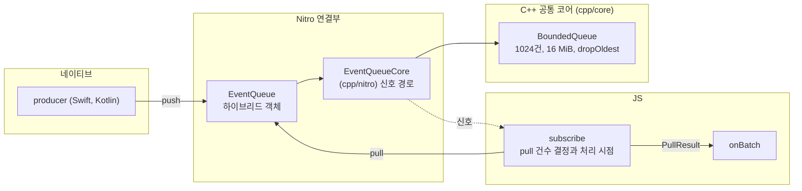

# react-native-velo

> 네이티브 이벤트가 몰릴 때 JS가 감당할 수 있는 만큼만 가져가게 하는 React Native 라이브러리
>
> 네이티브 producer가 넣은 이벤트를 C++ `BoundedQueue`에 모아 JS가 처리할 수 있는 만큼 묶어서 가져가는 구조

[](https://github.com/opficdev/react-native-velo/actions/workflows/ci.yml)

## 프로젝트 개요

이벤트는 네이티브 producer의 `push`에서 시작해 `BoundedQueue`와 Nitro 하이브리드 객체를 거쳐 JS subscriber의 `onBatch`로 전달

| 영역 | 담당 | 위치 |
|---|---|---|
| 네이티브 producer | 받은 스트림에 직접 `push` | 사용하는 앱의 모듈 (예제: `example/producer/`) |
| C++ 공통 코어 | `BoundedQueue`의 건수와 바이트 제한, 신호 대기 판정 | `cpp/core/` |
| 연결 클래스 | 고정값(1024건, 16 MiB, `dropOldest`), 신호 경로, `Batch`를 `PullResult`로 변환 | `cpp/nitro/EventQueueCore` |
| Nitro 하이브리드 객체 | `EventQueue`를 Swift와 Kotlin으로 구현하고 둘 다 `EventQueueCore`를 호출 | `ios/`, `android/` |
| JS subscriber | `createEventStream`, `subscribe`의 `pull` 건수 결정과 플랫폼별 처리 시점, `connect` | `src/` |



## 주요 기능

- 신호를 받으면 JS가 처리할 수 있는 만큼만 `pull`로 가져가고 처리 시점은 플랫폼별로 분리
	- iOS는 프레임마다 14ms 안에서 `pull`을 이어서 처리하고 프레임마다 이벤트 루프로 반환
	- Android는 신호마다 바로 `pull`하고 양보 없음
- 건수와 바이트 상한(1024건, 16 MiB)을 둔 큐
  - 가득 차면 오래된 이벤트부터 폐기하고 폐기 건수는 `PullResult.dropped`로 전달

## 설치

- [Releases](https://github.com/opficdev/react-native-velo/releases)에서 설치할 버전을 골라 `<버전>`에 입력

```bash
npm install https://github.com/opficdev/react-native-velo/releases/download/<버전>/react-native-velo-<버전>.tgz react-native-nitro-modules@^0.37.1
```

- `react-native-nitro-modules`는 peer dependency라 함께 설치
- `peerDependencies` 범위
	- `react`: `*`
	- `react-native`: `^0.88.0`
	- `react-native-nitro-modules`: `^0.37.1`

## 사용 흐름

첫 사용은 producer 선언, 네이티브 `push`, JS 연결의 세 단계

- iOS는 설치 뒤 `ios/` 폴더에서 `pod install` 실행
- producer 모듈을 직접 만드는 경우 모듈이 라이브러리에 의존하도록 설정 필요

### 1. producer 선언

`EventQueue`를 받는 `start`와 `stop`을 가진 Nitro 모듈 선언

```ts
// example/producer/src/specs/example-producer.nitro.ts
import type { HybridObject } from 'react-native-nitro-modules';
import type { EventQueue } from 'react-native-velo/src/specs/event-queue.nitro';

export interface ExampleProducer extends HybridObject<{
  ios: 'swift';
  android: 'kotlin';
}> {
  // 스트림을 받아 생산 시작
  start(stream: EventQueue): void;
  // 생산 중단과 스트림 참조 해제
  stop(): void;
}
```

### 2. 네이티브 `push`

받은 스트림에 `push`

```swift
// example/producer/ios/HybridExampleProducer.swift
import EventStream
import Foundation
import NitroModules

final class HybridExampleProducer: HybridExampleProducerSpec {
  func start(stream: (any HybridEventQueueSpec)) throws {
    var count = UInt64(0)
    // ... 100ms마다 실행되는 타이머의 이벤트 핸들러 안
    count += 1
    // 이 파일에 버퍼 타입 이름이 없으면 push가 보이지 않아 타입 명시
    let buffer: CounterBuffer = makeCounterBuffer(count)
    // dispose된 큐의 push는 오류 없이 무시되므로 결과 확인 생략
    try? stream.push(data: buffer)
    // ...
  }
}
```

- Android producer는 Kotlin으로 같은 `start`와 `stop`을 구현하며 예제는 [`HybridExampleProducer.kt`](example/producer/android/src/main/java/com/margelo/nitro/exampleproducer/HybridExampleProducer.kt) 참고
- 주의: Swift에서 `EventStream`을 가져오는 파일은 `ArrayBuffer` 직접 사용 불가, `example/producer/ios/CounterBuffer.swift`의 별칭 사용
- 주의: 컴파일러 버전마다 거부하는 표기가 달라 이 별칭 사용, 원인은 확인 못함

### 3. JS 연결

`createEventStream`으로 만든 스트림에 subscriber와 producer 연결

```ts
// example/bench/runner.ts 발췌
const stream = createEventStream();
const unsubscribe = stream.subscribe(onBatch);
const disconnect = stream.connect(producer);
// 종료 시점에 unsubscribe()와 disconnect() 호출
```

- `onBatch`는 `PullResult`(`items`, `dropped`)를 받는 함수, `producer`는 1단계에서 선언한 모듈의 하이브리드 객체
- `subscribe`와 `connect`는 해제 함수를 반환, 호출 순서 제한 없음
- producer 모듈이 라이브러리에 의존하도록 설정 필요
	- iOS는 podspec에 `s.dependency 'EventStream'` 필요
	- Android는 `find_package(react-native-velo REQUIRED CONFIG)`와 `react-native-velo::EventStream` 링크와 Gradle의 `project(":react-native-velo")` 의존 필요
- 전체 흐름은 [`example/`](example)과 [`example/producer/`](example/producer)에서 확인 가능

## 핵심 성과

네이티브 producer가 보내는 이벤트를 JS가 따라가지 못하거나 JS 스레드가 오래 막힐 때를, 라이브러리를 쓰지 않은 Nitro 콜백 경로(B)와 이 라이브러리의 큐 경로(Q)로 비교한 결과

- 1번과 2번의 표는 #30 이전 구현(적체가 이어지면 `setTimeout(fn, 0)`으로 양보)의 측정이며 #30의 변경은 3번에 기록
- 두 경로를 같은 앱 실행 안에서 번갈아 측정, 표의 값은 3회 중앙값이며 각 칸은 B / Q 순서
- `*`는 B와 Q의 3회 범위가 겹쳐 차이로 보지 않는 값
- 센서: 가속도계와 자이로스코프의 샘플 하나(128B), 200/s는 Android가 권한 없이 허용하는 상한
- 오디오 청크: 48kHz 32비트 스테레오 PCM을 20ms 단위로 자른 조각(7,680B), 50/s
- 서버 메시지: 채팅, 알림, 시세처럼 서버가 실시간으로 보내는 JSON 메시지(크기가 64B에서 수십 KB까지 섞여 평균 약 1.5KB), 5,000/s는 메시지가 한꺼번에 몰리는 경우
- 카메라: 카메라 영상 한 장(720p YUV420은 1,382,400B), 30/s는 30fps
- 핸들러: 가져온 이벤트를 처리하는 앱 코드
- Batch: 큐에서 한 번에 가져온 이벤트 묶음
- 양보: 처리 시간 한도에 닿으면 다른 JS 작업이 실행되도록 스레드를 비우는 동작
- 핸들러 오버: 핸들러가 이벤트 하나를 처리하는 시간을 발행 간격으로 나눈 값, 1을 넘으면 처리가 이벤트를 따라가지 못함
- JS 막힘: 핸들러와 무관한 작업이 JS 스레드를 막는 시간
- 루프 지연: 10ms 간격 JS 타이머가 예정보다 늦게 실행된 시간으로, JS 타이머 밀림의 지표
- 이벤트 지연: 이벤트 발행 시각부터 핸들러에서 처리가 시작되는 시각까지의 시간

### 1. 핸들러가 이벤트를 따라가지 못할 때 JS 타이머 밀림 감소

> **문제**: 핸들러가 이벤트 하나를 발행 간격보다 오래 처리하면 Nitro 콜백 경로에서 JS 스레드가 계속 점유되어 JS 타이머가 수 초에서 십수 초 지연
>
> **해결**: JS는 처리 시간 한도 안에서만 Batch를 가져가고 한도에 닿으면 양보
>
> **성과**: 핸들러 오버 1.2에서 루프 지연 상위 1% 감소
>
> - iOS: 11,996~12,100ms에서 14~110ms로
> - Android: 1,096~3,675ms에서 57~246ms로

| 이벤트 | 플랫폼 | 루프 지연 상위 1% (ms) B / Q | 이벤트 지연 상위 1% (ms) B / Q | 처리량 (건/초) B / Q | Q 폐기 (%) |
|---|---|---|---|---|---|
| 센서 128B, 200/s | iOS | 12,004 / 14 | 1,997 / 6,076 | 166 / 124 | 0 |
| 센서 128B, 200/s | Android | 2,090 / 113 | 2,337 / 5,882 | 164 / 127 | 0 |
| 서버 메시지 평균 약 1.5KB, 5,000/s | iOS | 12,100 / 23 | 2,093 / 307 | 4,128 / 3,032 | 37 |
| 서버 메시지 평균 약 1.5KB, 5,000/s | Android | 3,675 / 57 | 4,600 / 391 | 3,065 / 2,452 | 50 |
| 카메라 720p 1,382,400B, 30/s | iOS | 12,047 / 30 | 1,994 / 441 | 25 / 25* | 13 |
| 카메라 720p 1,382,400B, 30/s | Android | 1,096 / 115 | 1,114 / 563 | 9.2 / 19 | 32 |

- Q의 이점은 JS 타이머를 살리는 것이고 이벤트 지연과 처리량은 조합에 따라 갈림
	- 빈도가 높거나 이벤트가 큰 조합은 Q가 일부를 폐기하고 이벤트 지연도 감소
	- 센서 200/s와 오디오 청크처럼 빈도가 낮은 조합은 쌓인 양이 큐 상한에 못 미쳐 폐기 없이 이벤트 지연이 늘고 처리량이 저하
- 낮은 빈도에서 Q의 이벤트 지연이 길어지는 원인은 양보 대기
	- iOS 센서 200/s의 핸들러 오버 1.2에서 Q는 양보 480회에 구간의 25.6%(약 2,050ms)를 대기하고, 한 번의 대기는 중앙값 4.6ms
	- 이벤트 하나의 핸들러 시간은 B와 Q 모두 6.0ms이고, 양보를 없앤 빌드의 Q는 처리량이 B와 같은 166건/초
	- 주의: iOS는 빌드 한 쌍에서만, Android는 핸들러 오버 0.9와 1.2에서만 확인

### 2. JS가 오래 막혀도 이벤트 지연과 메모리를 큐 한도 안으로 제한

> **문제**: JS 스레드가 막힌 동안 쌓인 이벤트를 Nitro 콜백 경로는 막힘이 풀린 뒤 모두 처리해야 해서 지연과 메모리가 막힌 시간만큼 증가
>
> **해결**: `BoundedQueue`에 건수와 바이트 상한(1024건, 16 MiB)을 두고 가득 차면 오래된 이벤트부터 폐기하며 폐기 건수를 `PullResult.dropped`로 전달
>
> **성과**: 5초 막힘에서 이벤트 지연 중앙값 감소
>
> - 서버 메시지 5,000/s: iOS 3,121ms에서 0.03ms로, Android 3,135ms에서 0.71ms로
> - 카메라 720p 30/s: iOS 4,174ms에서 0.49ms로, Android 4,207ms에서 25ms로
> - iOS 메모리 증가: 서버 메시지 5,000/s는 32MB에서 0MB로, 카메라 720p는 46MB에서 0MB로

| 이벤트 | 플랫폼 | 이벤트 지연 중앙값 (ms) B / Q | 메모리 증가 (MB) B / Q | Q 폐기 (%) | B 한도 도달 |
|---|---|---|---|---|---|
| 센서 128B, 200/s | iOS | 1,971 / 1,973* | 0.48 / 1.1* | 0 | 0/3 |
| 센서 128B, 200/s | Android | 1,992 / 1,993* | 1.2 / 1.0* | 0 | 0/3 |
| 서버 메시지 평균 약 1.5KB, 5,000/s | iOS | 3,121 / 0.03 | 32 / 0.00 | 56 | 3/3 |
| 서버 메시지 평균 약 1.5KB, 5,000/s | Android | 3,135 / 0.71 | 1.6 / 8.1* | 56 | 3/3 |
| 카메라 720p 1,382,400B, 30/s | iOS | 4,174 / 0.49 | 46 / 0.00 | 52 | 3/3 |
| 카메라 720p 1,382,400B, 30/s | Android | 4,207 / 25 | 30 / 31* | 50 | 3/3 |

- 막힌 동안 쌓이는 양이 큐 상한을 넘는 조합(초당 1,000건 이상의 센서와 서버 메시지, 카메라)에서만 차이, 센서 200/s처럼 상한 아래의 조합은 B와 동일
- 표에 없는 센서 1,000/s와 서버 메시지 1,000/s, 카메라 VGA(460,800B)도 같은 경향이며 이벤트 지연 중앙값이 iOS는 2,575ms 이하에서 0.10~75ms로, Android는 2,548ms 이하에서 16~67ms로 감소
- 대가로 이벤트의 38~56%를 폐기, 폐기 건수는 `PullResult.dropped`로 확인
- B 한도 도달: 측정 도구가 B의 처리 대기 한도(2만 건 또는 64MB)에 닿아 발행을 멈춘 실행 수, 한도가 없는 앱에서는 처리 대기가 계속 증가
- 메모리는 iOS에서만 차이, Android는 3회 범위가 겹침
- 700ms 막힘은 서버 메시지 5,000/s와 카메라 720p에서만 차이
	- 서버 메시지 5,000/s의 이벤트 지연 상위 1%는 iOS 675ms에서 184ms로, Android 686ms에서 194ms로 감소
	- 카메라 720p의 이벤트 지연 상위 1%는 iOS 680ms에서 376ms로, Android 684ms에서 379ms로 감소
- 50ms 막힘은 Android 오디오 청크 50/s의 이벤트 지연 상위 1%만 217ms에서 86ms로 감소
- 주의: 측정 도구의 한도가 없던 Android 실행에서 B가 카메라 720p와 5초 막힘 조합에서 `OutOfMemoryError`로 앱 종료, 한 번의 기록

### 3. 플랫폼별 처리 시점으로 iOS 타이머 막힘과 Android 양보 부작용 제거

> **문제**: 이전 구현은 큐가 100ms 이상 비지 않을 때만 양보해서, 배치마다 고정 비용이 드는 핸들러는 iOS에서 JS 타이머가 약 10,000ms 막히고 Android 핸들러 오버 0.9는 양보가 적체를 유지해 3회 중 1회 처리량이 떨어짐
>
> **원인**: iOS는 타이머를 JS 스레드 run loop의 CADisplayLink가 호출해서 신호가 이어지면 호출되지 못하고, Android는 타이머 태스크가 신호 처리 사이에 끼어들어 막히지 않으며 양보 한 번이 다음 vsync까지 기다려 약 12ms가 듦
>
> **해결**: 플랫폼별 구현 분리
>
> - iOS: 프레임마다 14ms 안에서 `pull`을 이어서 처리하고 프레임마다 이벤트 루프로 반환
> - Android: 신호마다 바로 `pull`하고 양보 없음

- 이전 구현(`develop`)과 #30 구현을 같은 앱에서 각각 빌드해 경로 Q만 3회씩 측정, 범위는 3회의 최솟값~최댓값
- 루프 지연: 10ms 간격 JS 타이머가 예정보다 늦게 실행된 시간의 상위 1%, 이벤트 지연: 이벤트 발행부터 핸들러 시작까지의 상위 1%

| 이벤트 | 플랫폼 | 루프 지연 (ms) 이전 / #30 | 이벤트 지연 (ms) 이전 / #30 | 처리량 (건/초) 이전 / #30 |
|---|---|---|---|---|
| 고정 비용 8ms, 센서 200/s | iOS | 9,997~10,004 / 24~25 | 11 / 20 | 200 / 200 |
| 고정 비용 8ms, 센서 1,000/s | iOS | 10,000~10,004 / 17~25 | 10 / 15~16 | 1,000 / 1,000 |
| 고정 비용 8ms, 서버 메시지 1,000/s | iOS | 10,000~10,004 / 24~25 | 10 / 15~16 | 1,000 / 1,000 |
| 핸들러 오버 0.9, 센서 200/s | iOS | 10 / 24~25 | 0~8 / 14~16 | 200 / 200 |
| 핸들러 오버 1.2, 센서 200/s | iOS | 14 / 20 | 6,074~6,078 / 2,239~2,252 | 124 / 163 |
| 고정 비용 8ms, 센서 200/s | Android | 31 / 31~32 | 12 / 11~264 | 200 / 200 |
| 고정 비용 8ms, 센서 1,000/s | Android | 26~35 / 26~35 | 10 / 9~10 | 1,000 / 1,000 |
| 고정 비용 8ms, 서버 메시지 1,000/s | Android | 27~35 / 28~51 | 9~10 / 9~253 | 999 / 1,000 |
| 핸들러 오버 0.9, 센서 200/s | Android | 25~98 / 23~25 | 2~1,684 / 1~3 | 200 / 200 |
| 핸들러 오버 1.2, 센서 200/s | Android | 49~92 / 39~44 | 5,376~5,623 / 2,051~2,059 | 129 / 166 |

- iOS의 고정 비용 8ms 조합은 루프 지연이 약 10,000ms에서 17~25ms로 감소하고 처리량은 유지
- iOS 핸들러 오버 1.2는 처리량이 124건/초에서 163건/초로 늘고 이벤트 지연이 6,074ms에서 2,239ms로 감소
- Android 핸들러 오버 0.9는 3회 모두 처리량 200건/초이고 이벤트 지연이 1~3ms, 이전 구현은 3회 중 1회가 1,684ms
- Android 핸들러 오버 1.2는 처리량이 129건/초에서 166건/초로 늘고 이벤트 지연이 5,376ms에서 2,051ms로 감소
- 대가
	- iOS는 JS에 여유가 있을 때도 이벤트가 프레임 단위로 처리되어 이벤트 지연이 5~15ms 증가
	- Android 고정 비용 8ms의 두 조합에서 3회 중 1회가 이벤트 지연 250ms대로 튀었고 원인 확인 못함
- 프레임 단위 처리를 Android에 적용하지 않은 이유
	- Android는 프레임 한 번 안에 끝나지 않은 처리가 다음 vsync까지 밀려 핸들러 오버 0.9에서 묶음 4건(18ms)이 33ms 주기로 돌아 처리량이 약 120건/초로 떨어짐
	- 처리 한도를 8ms로 둔 프레임 단위 처리는 iOS와 Android 모두 핸들러 오버 0.9에서 약 120건/초로 떨어짐
- 주의: iOS의 B 경로 전용 고정 비용 조합은 앱이 중간에 종료되어 제외, 종료 원인 확인 못함
- 주의: 120Hz와 저전력 모드와 실기기에서는 측정 안 함

### 효과가 없거나 오히려 나쁜 조건

- 처리가 이벤트를 따라가는 조건(핸들러 오버 0.5와 0.9, 50ms 막힘)은 B와 비슷
	- iOS는 처리량이 같고 이벤트 지연 중앙값 차이가 0.06ms 이내
	- Android는 일부 조합에서 Q가 B보다 악화
		- 핸들러 오버 0.9의 센서 200/s는 처리량이 200건/초에서 154건/초로, 이벤트 지연 상위 1%가 149ms에서 3,192ms로 악화
		- 핸들러 오버 0.5의 서버 메시지 5,000/s는 Q가 6.7%를 폐기하고 B는 폐기 없이 처리
	- Android 핸들러 오버 0.9의 Q 악화는 양보가 원인
		- Q는 양보 125~198회에 1,296~1,849ms를 대기하고, 양보를 없앤 빌드의 Q는 처리량이 B와 같은 200건/초
		- 양보 한 번의 중앙값은 7~10ms이고, 양보 사이에 이어서 처리하는 시간은 최대 32ms
	- 주의: 양보에 처음 들어가는 계기는 확인 못함
	- 주의: 핸들러 오버 0.5의 폐기와 지연 상위 1% 악화는 다시 측정한 3회에서 재현되지 않아 원인 확인 못함
		- 서버 메시지 5,000/s는 폐기 0건이고, 센서 1,000/s는 이벤트 지연 상위 1%의 3회 범위가 B와 겹침
- Batch마다 고정 비용(8ms)이 드는 핸들러는 Q가 JS 타이머를 막음(iOS만 측정)
	- 센서 200/s와 1,000/s, 서버 메시지 1,000/s에서 루프 지연 상위 1%가 B 약 8ms, Q 약 10,000ms
	- B에도 호출마다 같은 고정 비용을 매기면 B의 루프 지연 상위 1%는 센서 200/s 16,210ms, 나머지 둘 약 81,000ms이고 처리량은 123건/초
		- B 약 8ms는 B가 Batch 고정 비용을 내지 않은 조건의 차이
		- 같은 고정 비용에서는 Q가 B보다 처리량이 높고 타이머는 두 경로 모두 막힘
	- Q의 양보는 0회이고 JS가 구간의 99.8% 이상 동안 핸들러를 실행
		- Batch마다 8ms가 들면 pull마다 큐가 비어 양보 조건(큐가 100ms 이상 비지 않음)에 닿지 않음
		- 양보를 없앤 빌드에서도 Q의 루프 지연은 약 10,000ms로 같음
	- 이 조합과 Android 핸들러 오버 0.9는 #30에서 플랫폼별 구현으로 해결, 3번에 기록

### 측정 조건

| 항목 | 내용 |
|---|---|
| 기기 | iOS는 iPhone 18 Pro 시뮬레이터(iOS 27.0), Android는 `velo_example` 에뮬레이터(Android 16) |
| 빌드 | Release |
| 이벤트 | 센서(가속도·자이로 샘플) 128B 100/s·200/s·1,000/s, 오디오 청크(48kHz 32비트 스테레오 PCM) 20ms 7,680B 50/s와 100ms 38,400B 10/s, 서버 메시지(JSON, 크기 혼합) 평균 약 1.5KB 100/s·1,000/s·5,000/s, 카메라(YUV420 영상 한 장) VGA 460,800B와 720p 1,382,400B 30/s |
| 핸들러 오버 | 0.5, 0.9, 1.2, JS 막힘 없음 |
| JS 막힘 | 50ms, 700ms, 5초를 2초 간격으로, 가벼운 핸들러 |
| 구간 | 워밍업 2초, 측정 8초, 조합당 3회, 회차마다 B와 Q의 순서를 섞음 |
| 규모 | 이벤트 10종 × (핸들러 오버 3단계 + JS 막힘 3단계) = 60조합, 플랫폼당 360회 |

### 측정의 한계

- 주의: 시뮬레이터와 에뮬레이터에서만 측정해 실제 앱의 JS 부하와 UI 프레임 영향은 확인 못함
- 주의: 센서 128B, 오디오 청크 길이, 서버 메시지의 크기 분포는 근거 자료 없이 정한 가정
- 주의: 핸들러 오버 0.5, 0.9, 1.2와 JS 막힘 50ms, 700ms, 5초는 부하 시험 관행과 Android 기준을 빌린 값이며 실제 앱이 이런 오버로드를 얼마나 자주 겪는지는 측정 안 함
- 주의: B와 Q를 같은 프로세스에서 연속 실행해 메모리 비교는 대략적인 값
- 주의: `subscribe`의 내부 상수는 장치에서 정하지 않음

## 기술 스택

| 구분 | 내용 |
|---|---|
| 언어 | TypeScript 6.0.3, Swift, Kotlin, C++ |
| 런타임 의존 | `react`(`*`), `react-native`(`^0.88.0`), `react-native-nitro-modules`(`^0.37.1`) (`peerDependencies`) |
| 확인된 빌드 환경 | React Native 0.88.0, React 19.3.0, `react-native-nitro-modules` 0.37.1 |
| 코드 생성 | `nitrogen` 0.37.1 |
| 빌드 | `react-native-builder-bob` 0.40.18 |
| 정적 검사 | ESLint 10.13.0, Prettier 3.9.10, SwiftLint 0.65.1, ktlint 1.8.0, clang-format 23.1.3 |
| 자동화 | GitHub Actions, `mise`(Node 24.22.0, Java temurin 21, Ruby 4.0.7), `npm`, `Makefile` |

- `react-native`와 `react-native-nitro-modules`의 범위는 배포물에 들어간 `nitrogen` 0.37.1의 생성 코드와 빌드를 확인한 React Native 0.88.0에 맞춘 값
- iOS는 `min_ios_version_supported`를 따르며 React Native 0.88.0에서는 15.1
- Android는 라이브러리 기본값(`EventStream_minSdkVersion`)이 23이고 예제 앱의 `minSdkVersion`이 24
- 주의: visionOS 1.0은 podspec에 선언만 있고 visionOS와 Android SDK 23 빌드는 CI에서 미확인
- 네이티브 producer는 iOS에서 Swift, Android에서 Kotlin으로 구현
- 배포물에 Nitro 생성 코드(`nitrogen/`)와 빌드 결과(`lib/`) 포함, 사용 앱의 코드 생성 실행 불필요

## 한계

- 큐 크기(1024건, 16 MiB)와 가득 찼을 때의 정책은 측정으로 정하지 않은 고정값, 설정 API 없음
- iOS는 프레임 단위로 처리해 JS에 여유가 있을 때도 이벤트 지연이 프레임 한 번 안쪽으로 늘어남
- Android는 양보가 없어 렌더와 터치가 늦어지는 정도를 직접 측정 못함, JS 프레임과 UI 프레임 드롭은 정상
- 120Hz와 저전력 모드와 실기기는 측정 안 함, 처리 시점이 주사율에 따라 달라질 수 있음
- 큐가 가득 차면 오래된 이벤트부터 버려 손실이 허용되지 않는 데이터에는 부적합
	- 버린 건수만 `PullResult.dropped`로 확인 가능하고 버린 이벤트는 복구 불가
	- 가득 찼을 때 producer에 `push` 중단을 알리는 방법 없음
- 스트림당 producer 하나와 subscriber 하나만 지원
- npm 레지스트리에 올라가 있지 않아 `npm install react-native-velo`로 설치 불가
- `^0.1.0` 같은 버전 범위로 자동 업데이트 불가, 버전마다 URL 변경
- JS가 이벤트를 따라가는 조건에서는 B와 차이가 거의 없고 일부 조합은 오히려 이벤트 지연이 늘어남, [효과가 없거나 오히려 나쁜 조건](#효과가-없거나-오히려-나쁜-조건) 참고
- 측정 조건의 한계는 [측정의 한계](#측정의-한계) 참고

## 라이선스

MIT
